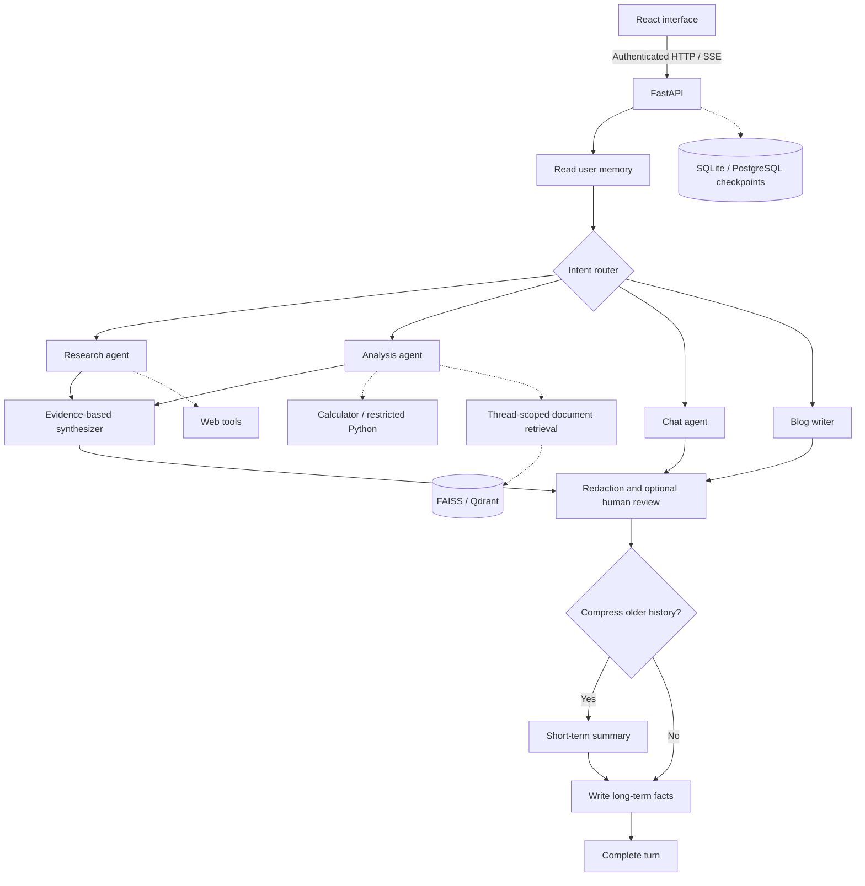

# AgentFlow

**A stateful AI assistant for web research, document analysis, conversational help, and structured blog writing.**

[](https://github.com/thenithin342/AgentFlow/actions/workflows/ci.yml)
[](https://www.python.org/)
[](https://react.dev/)
[](LICENSE)

AgentFlow combines a FastAPI backend, a LangGraph workflow, and a React interface. It routes each message to a specialist, retrieves evidence when needed, preserves conversation state, and supports approval or editing before a response is finalized.

The project focuses on the engineering around an LLM: state management, tool execution, user isolation, provider failures, observability, and measurable answer quality.

**Deployment links:** [Web app](https://agent-flow-smoky.vercel.app) · [API documentation](https://agentflow-pl48.onrender.com/docs)

> Deployment links may run an earlier revision. Evaluation results below describe local audit runs, not a guarantee about the hosted version.

## Contents

- [Capabilities](#capabilities)
- [Architecture](#architecture)
- [Design decisions and tradeoffs](#design-decisions-and-tradeoffs)
- [Run locally](#run-locally)
- [API overview](#api-overview)
- [Evaluation and verification](#evaluation-and-verification)
- [Configuration](#configuration)
- [Security and deployment considerations](#security-and-deployment-considerations)
- [Project structure](#project-structure)
- [Explaining the project in an interview](#explaining-the-project-in-an-interview)
- [Known limitations and next steps](#known-limitations-and-next-steps)

## Capabilities

| Capability | Implementation |
|---|---|
| Intent routing | Four routes: research, analysis, chat, and blog. Document-aware overrides and deterministic fallback preserve useful behavior when classification fails. |
| Web research | ReAct agent with Tavily search, Wikipedia, URL reading, and current date/time tools. |
| Document analysis | PDF ingestion, thread-scoped retrieval, arithmetic calculator, restricted Python execution, and evidence-based synthesis. |
| Conversational help | Shorter graph path that skips the synthesizer; document retrieval remains available. |
| Blog writing | Structured output with a title, metadata, tags, and sections. |
| Persistent conversations | Checkpointed graph state and thread history; SQLite by default, optional PostgreSQL checkpointing. |
| Human review | LangGraph `interrupt()` pauses the workflow; `Command(resume=...)` continues with approval or an edited response. |
| Memory | Short-term history compression and user-scoped long-term fact retrieval across threads. |
| Live execution trace | Server-Sent Events expose node and tool progress, followed by the sanitized final answer. |
| Access and feedback | JWT login, admin user management, authenticated thread access, and feedback capture. |

## Architecture



Each turn selects **one specialist route**. Research and analysis pass through the synthesizer; chat and blog write their response directly. Specialist agents can make multiple tool calls within a turn. Parallel specialist fan-out is not implemented.

### Request lifecycle

1. **Authenticate and scope.** FastAPI validates the request. The authenticated user and client thread ID determine the internal checkpoint and document namespace.
2. **Restore context.** LangGraph loads the checkpoint; the memory reader adds relevant user facts.
3. **Route.** The classifier selects a specialist. Factual questions about uploaded documents are directed to analysis; explicit web-research requests retain the research route.
4. **Collect evidence.** Agents call their tools. Analysis retrieves document context before model execution, so retrieval does not depend entirely on the model choosing a tool.
5. **Produce a response.** For research and analysis, the synthesizer receives actual tool evidence. Document synthesis avoids using the unchecked agent draft as its factual source.
6. **Review and persist.** Response redaction runs before delivery. Review mode exposes a sanitized draft for approval or editing. The graph then updates memory and completes the turn.

### Retrieval pipeline

```text
PDF upload → parse pages → split text → embed chunks → thread-scoped vector store
Question → vector candidates → lexical scoring + reciprocal rank fusion → evidence
```

- Chunks use `RecursiveCharacterTextSplitter` with an 800-character size and 150-character overlap.
- Google embeddings default to `models/gemini-embedding-001`, with 3,072 dimensions.
- Retrieval fetches a wider candidate pool and combines semantic and lexical ranks. Semantic order resolves fusion ties.
- Document citations retain the original filename and page number.
- FAISS is the local default. Configuring Qdrant enables shared vector storage for both documents and long-term memory.

### Model roles

These are **repository configuration defaults**, not claims about provider availability or pricing.

| Role | Default model | Configuration |
|---|---|---|
| Router and specialist tool loops | Groq `openai/gpt-oss-20b` | `GROQ_FAST_MODEL` |
| Synthesizer and blog writer | Groq `openai/gpt-oss-120b` | `GROQ_SMART_MODEL` |
| Application LLM fallback | Google `gemini-2.5-flash` | `GOOGLE_MODEL` |
| Document and memory embeddings | Google `models/gemini-embedding-001` | `EMBED_MODEL`, `EMBED_DIM` |

The application tries configured Groq keys and can fall back to Gemini. Keys belonging to the same organization may share quota. Evaluation judges keep a fixed model/provider for comparable scores; application fallback and judge fallback have different requirements.

## Design decisions and tradeoffs

| Decision | Reason | Tradeoff |
|---|---|---|
| Explicit LangGraph workflow | Makes routing, checkpoints, review interrupts, and memory transitions inspectable. | More orchestration code than a single prompt chain. |
| Separate fast and smart model roles | Reserves the larger model for synthesis and structured writing. | Additional synthesis calls increase latency and token use. |
| Mandatory retrieval for document analysis | Prevents a model from answering a document question without consulting the document. | Retrieval adds latency and can still return incomplete evidence. |
| Semantic and lexical rank fusion | Preserves meaning-based matches while promoting useful exact terms. | The lexical normalization is English-oriented and is not a learned reranker. |
| SQLite and FAISS defaults | Keeps local setup small and state easy to inspect. | Local files and process-local coordination limit deployment scaling. |
| SSE progress with buffered answer text | Keeps execution visible while allowing redaction before answer text reaches the client. | Users wait for generation to finish before seeing answer text. |
| Checkpointed human review | Approval survives beyond a single HTTP request and resumes the same graph. | Clients must handle interrupted and completed turns separately. |

## Run locally

### Prerequisites

- Python **3.11+**; the backend CI uses Python 3.12.
- Node.js **20.19+ on the 20.x line, or 22.12+** for the installed Vite version.
- A Groq key for the default LLM path, a Google AI key for embeddings and Gemini fallback, and a Tavily key for web research.

Provider access and quotas depend on your account. Chat may run without all tool providers, but document ingestion and memory embeddings require Google access, and web search requires Tavily.

### 1. Install the backend

```bash
git clone https://github.com/thenithin342/AgentFlow.git
cd AgentFlow
python -m venv venv
```

Activate the environment:

```powershell
# Windows PowerShell
.\venv\Scripts\Activate.ps1
```

```bash
# macOS / Linux
source venv/bin/activate
```

```bash
python -m pip install -r requirements.txt
python -c "import shutil; shutil.copyfile('.env.example', '.env')"
```

### 2. Configure credentials

Edit `.env`. Set the following values; placeholders are intentionally not usable credentials:

```dotenv
ENVIRONMENT=dev
ADMIN_USERNAME=admin
ADMIN_PASSWORD=<choose-a-strong-password>
JWT_SECRET=<generate-a-random-secret>
GROQ_API_KEY=<your-groq-key>
GOOGLE_API_KEY=<your-google-ai-key>
TAVILY_API_KEY=<your-tavily-key>
LANGCHAIN_TRACING_V2=false
LANGSMITH_TRACING=false
```

Generate a JWT secret locally with:

```bash
python -c "import secrets; print(secrets.token_hex(32))"
```

The admin account is bootstrapped on a fresh user store. Changing `ADMIN_PASSWORD` later does not update an existing account; use the admin password-management endpoint. Keep `.env` and runtime state out of Git.

### 3. Start the backend

```bash
python -m uvicorn backend.main:app --reload --port 8000
```

- API documentation: [http://localhost:8000/docs](http://localhost:8000/docs)
- Liveness: [http://localhost:8000/healthz](http://localhost:8000/healthz)
- Readiness: [http://localhost:8000/readyz](http://localhost:8000/readyz)

Readiness includes dependency checks and can report unavailable embeddings even when the HTTP server is running.

### 4. Start the frontend

In another terminal:

```bash
cd frontend
npm ci
npm run dev
```

Open [http://localhost:5173](http://localhost:5173) and sign in with the configured admin credentials. Vite proxies API requests to the local backend. A separately hosted frontend uses `VITE_API_BASE` to select its API origin.

### 5. Try a complete workflow

1. Start a new chat and upload a text-based PDF.
2. Ask a factual question about the document and inspect its source references.
3. Start another chat and request current web research; inspect tool progress.
4. Enable review mode, submit a question, and approve or edit the draft.
5. Restart the backend and reopen the thread to verify persisted state.

## API overview

Protected endpoints accept `Authorization: Bearer <access_token>`. Login returns a JWT. A configured static API key is also supported for service access; it represents a shared identity.

| Endpoint | Purpose |
|---|---|
| `POST /auth/login` | Exchange username/password for an access token. |
| `POST /auth/refresh` | Renew an eligible token. |
| `POST /chat` | Run a conversation turn and receive SSE events. |
| `POST /upload` | Upload a PDF using multipart fields `file` and `thread_id`. |
| `POST /review/{thread_id}` | Approve or edit an interrupted turn. |
| `GET /threads` | List the authenticated user's conversations. |
| `GET /threads/{thread_id}/history` | Read conversation history. |
| `GET /threads/{thread_id}/state` | Inspect current graph state. |
| `GET /threads/{thread_id}/blog` | Read structured blog output. |
| `DELETE /threads/{thread_id}` | Delete a conversation and its associated data. |
| `POST /feedback` | Record user feedback. |
| `/admin/users` | Admin user listing, creation, deletion, and password management. |
| `GET /healthz`, `GET /readyz` | Public liveness and readiness probes. |

The generated [OpenAPI schema](http://localhost:8000/docs) is the detailed request/response reference. `/chat` uses JSON input; `/upload` uses multipart input; review returns JSON.

### Chat request

```json
{
  "thread_id": "interview-demo",
  "message": "Summarize the uploaded report and cite the relevant pages.",
  "review_required": false
}
```

Messages are limited to 16,000 characters. Thread IDs must match `^[a-zA-Z0-9_-]{1,128}$`. PDF uploads are limited to 50 MiB; malformed PDFs return HTTP 400.

### SSE contract

```text
data: [NODE_START:research_agent|t=2026-10-21T10:00:00.000Z]

data: [TOOL_START:tavily_search]

data: [NODE_END:research_agent]

data: [FINAL:"A sanitized answer supported by the retrieved evidence."]

data: [SOURCES:2]

data: [DONE]
```

`[FINAL:...]` contains a JSON-encoded string and replaces any prior draft in the client. `[SOURCES:n]` is a source count. Review mode ends with `[INTERRUPT]` instead of `[DONE]`; the sanitized response is then a reviewable draft. Error and fallback frames are handled separately by the client.

Resume requests:

```json
{ "action": "approve" }
```

```json
{ "action": "edit", "edited_response": "The reviewed response." }
```

## Evaluation and verification

AgentFlow separates software correctness from model quality. Passing unit tests does not establish that answers are faithful or that a live provider meets a latency target.

### Evaluation layers

| Layer | What it checks |
|---|---|
| Deterministic Tier A | Routing/orchestration contracts, tool boundaries, schemas, retrieval structure, and safety regression cases using controlled inputs. |
| Real-provider Tier B | Eight golden datasets covering router, retriever, generator, RAG-QA, application, safety, memory, and blog behavior. |
| Online/API checks | Authentication, SSE, PDF upload and document QA, review/resume, readiness, and latency. |

The eight datasets contain **146 rows**. Retrieval uses recall and average precision at k; generation and RAG use faithfulness and relevancy judges. Application/blog rubrics, safety probes, and memory roundtrips cover different failure modes. Thresholds live in [`evals/config.yaml`](evals/config.yaml).

Reports retain dataset/config hashes, code fingerprints, model settings, errors, and completeness information. Judge failures and quota exhaustion must remain visible. A no-regression result against a weak baseline is not sufficient to pass absolute quality gates. Full RAG scoring uses the evidence actually returned by the graph.

### Run the checks

```bash
python -m pip install -r requirements-dev.txt
python evals/harness/validate_datasets.py
python -m evals.harness.run_offline --dry-run
python -m pytest -m tier_a -q
ruff check backend tests evals
```

```bash
# Backend suite and the current CI coverage gate
python -m pytest -m "not eval" --cov=backend --cov-report=term-missing --cov-fail-under=54

# Run these from frontend/
npm run lint
npm run test -- --run
npm run build
```

Some integration tests run live when provider credentials are available. The `not eval` marker excludes the LangSmith evaluation test; it is not a universal network-disable switch. Use an isolated test environment without provider credentials or a populated `.env` for the offline run. Test storage is isolated from application uploads and checkpoints.

Real-provider examples consume quota:

```bash
python -m evals.harness.run_offline router --out evals/results/my-run
python -m evals.harness.run_offline retriever --out evals/results/my-run
python -m evals.harness.run_offline rag-qa --out evals/results/my-run
```

The implemented judges use the existing provider SDKs. DeepEval is not required for this harness. See [`evals/README.md`](evals/README.md) for the complete evaluation commands and report interpretation.

### Local audit snapshot — 21 October 2026

| Check | Observed result |
|---|---|
| Backend suite | 440 passed, 23 skipped, 1 deselected; 63.66% coverage. |
| Final retrieval repair tests | 5 focused ranking tests passed after the full suite. |
| Frontend | 60 tests passed; lint and production build passed. |
| Router | 43/44 correct, with no provider errors. |
| Retriever | Recall 0.9583 and AP@5 0.8368; aggregate gates passed. |
| Memory | Entity recall and cross-thread roundtrip both 1.0; extraction precision remained informational. |
| Real local API suite | 5/6 scenarios passed; research latency was 21.161 seconds against a 15-second target. |
| Full RAG/application acceptance | Incomplete: fixed-model judge calls exhausted the provider's daily quota. |

These are separate audit runs, not a single all-green release batch. Small synthetic datasets provide regression evidence, not a general accuracy guarantee. The baseline was not promoted. See [`EVAL_AUDIT_2026-10-19.md`](EVAL_AUDIT_2026-10-19.md) for fixes, provenance, earlier results, and outstanding work.

## Configuration

[`.env.example`](.env.example) lists the full configuration; [`backend/settings.py`](backend/settings.py) defines typed application settings.

| Setting | Purpose / default |
|---|---|
| `ENVIRONMENT` | `dev` by default; production requires an explicit JWT secret. |
| `ADMIN_USERNAME`, `ADMIN_PASSWORD` | Bootstrap credentials for a new user store. |
| `JWT_SECRET` | Stable token-signing secret; development otherwise uses an ephemeral secret. |
| `AGENTFLOW_API_KEY` | Optional static service credential. |
| `GROQ_API_KEY`, `_2`, `_3` | Primary and optional fallback Groq keys. |
| `GOOGLE_API_KEY` | Embedding access and application Gemini fallback. |
| `TAVILY_API_KEY` | Web search access. |
| `GROQ_FAST_MODEL`, `GROQ_SMART_MODEL`, `GOOGLE_MODEL` | Override application model IDs without editing graph code. |
| `EMBED_MODEL`, `EMBED_DIM` | Embedding model and dimension; default dimension 3,072. |
| `CHECKPOINT_DB_PATH` | Local SQLite checkpoint/user database; default `agentflow.db`. |
| `POSTGRES_CONN_STRING` | Enables PostgreSQL graph checkpointing. |
| `FAISS_INDEX_DIR`, `LTM_INDEX_DIR` | Local vector-index locations. |
| `QDRANT_URL`, `QDRANT_API_KEY` | Optional shared vector store for documents and memory. |
| `AGENTFLOW_SECRET_DIR` | Directory containing the persistent FAISS signing secret. |
| `CORS_ORIGINS` | Allowed browser origins; use explicit origins in production. |
| `LANGCHAIN_TRACING_V2`, `LANGCHAIN_API_KEY` | Optional LangSmith tracing configuration. |
| `STREAM_TIMEOUT_SECONDS` | Backend chat-stream ceiling; default 300 seconds. |
| `VITE_API_BASE` | Frontend build-time API origin when using a separate host. |

Changing embedding dimensions or models requires a deliberate index migration/rebuild. Keep persistent paths and signing secrets stable across restarts.

## Security and deployment considerations

- **Identity boundaries:** JWT authentication scopes conversations and retrieval to users. Static API-key callers share a service identity; use individual logins when isolation between people is required.
- **Response handling:** final output, review drafts, and serialized history/state receive targeted redaction. Prompt delimiters and deterministic refusals add narrow safeguards; they do not establish general prompt-injection immunity.
- **Tool execution:** the calculator permits a constrained arithmetic AST. Python execution uses validation, restricted builtins, and a child-process timeout. This is not an operating-system security sandbox for arbitrary hostile code.
- **Uploads and indexes:** PDF size/type validation and signed FAISS artifacts reduce specific risks. Maintain control over the index directories and signing key.
- **Persistence:** SQLite/FAISS suit a single-instance deployment. PostgreSQL checkpoints and Qdrant address shared state, but the user/feedback database remains SQLite and coordination includes process-local locks. Switching those two backends alone does not make the entire application horizontally scalable.
- **Hosting:** preserve the database, indexes, and signing secret on persistent storage. Keep provider credentials on the backend and configure explicit production CORS origins. Tracing can send conversation/tool content to an external service; enable it deliberately.
- **Delivery:** the repository includes backend/frontend CI and a conditional Render deploy-hook job on pushes to `main`. A push can trigger hosting automation when repository secrets or hosting integrations are configured.

## Project structure

```text
backend/
  main.py                 FastAPI lifespan, middleware, graph initialization
  settings.py             Typed environment configuration
  auth.py                 Authentication and user-store helpers
  llm.py                  Lazy model clients, token budgets, provider fallback
  graph/
    build_graph.py        Workflow topology and graph factories
    router.py             Intent classification and route policy
    agents.py             Research, analysis, and chat execution
    blog_agent.py         Structured blog generation
    synthesizer.py        Evidence-based final response
    human_review.py       Interrupt/resume and response handling
    memory_nodes.py       Memory transitions
    response_safety.py    Targeted refusal and redaction rules
    tools.py              Search, retrieval, calculator, and Python tools
  rag/                    PDF ingestion and retrieval ranking
  memory/                 Long-term facts and short-term compression
  vectorstore/            Qdrant adapter
  routers/                Auth, chat, upload, threads, admin, feedback, health
frontend/
  src/                    React UI, authenticated API client, SSE reader
  tests/                  Component and hook regressions
evals/
  datasets/               Golden JSONL cases and synthetic PDF corpus
  harness/                Batch runners, judges, metrics, provenance, reports
  online/                 API checks, monitoring, feedback analysis
tests/                    Backend and evaluation-harness regressions
.github/workflows/        CI and evaluation automation
```

## Explaining the project in an interview

### A concise introduction

> “I built AgentFlow to explore how an AI assistant can keep state, use tools, and produce answers that can be evaluated. A FastAPI API drives a LangGraph workflow that selects research, analysis, chat, or blog writing. Document questions retrieve thread-scoped evidence, and research/analysis answers go through a synthesizer. Checkpoints support conversation recovery and human approval. I evaluate the orchestration separately from real-model quality so passing software tests cannot hide hallucinations or provider failures.”

### Questions worth being ready to answer

| Question | Concrete explanation |
|---|---|
| Why use a graph? | The workflow has explicit branches, persisted transitions, and an approval interrupt. Walk through `build_graph.py` and show how a paused thread resumes. |
| How do you reduce hallucinations? | Retrieve before document analysis, pass actual tool evidence to synthesis, remove unsupported draft anchoring, and measure faithfulness. Acknowledge that relevant retrieval and a good prompt cannot guarantee correctness. |
| How are users separated? | The server derives identity from authentication and combines it with the thread ID; checkpoint and retrieval namespaces follow that scope. The request's claimed user ID is not the authority. |
| Why two model roles? | The smaller role handles routing/tool loops; the larger role handles synthesis/blog output. Explain the extra latency and measure it instead of assuming this is always faster or cheaper. |
| Why buffer the answer if SSE is available? | Draft tokens can contain information that final redaction would remove. Node/tool progress stays live; answer delivery waits for sanitization. |
| What did evaluation change? | It exposed missing golden-corpus facts, scoring against the wrong evidence, retrieval-order regressions, provider failures disguised as chat, and floating-point threshold errors. Each repair has regression coverage. |
| What prevents a production-readiness claim? | Incomplete final RAG/application validation, research latency above target, small datasets, and remaining single-instance state/coordination. Describe these limits before discussing scaling. |

For a demonstration, show a document question with citations, a review interrupt/resume, a persisted thread after restart, and an evaluation report containing both quality scores and operational failures.

## Known limitations and next steps

1. **Complete acceptance runs:** rerun the full RAG-QA and application datasets with sufficient fixed-model judge quota. Do not promote incomplete reports to the baseline.
2. **Research latency:** the measured local request exceeded the 15-second target. Profile tool roundtrips, model calls, and memory writes before making further changes.
3. **Retrieval coverage:** the regional-comparison probe still misses one expected passage despite passing aggregate retrieval gates. English suffix normalization and small synthetic corpora limit what the score establishes.
4. **Broader safety evidence:** refusal/redaction patterns cover selected cases and can miss novel attacks or mask legitimate data. Extend adversarial and false-positive coverage.
5. **Deployment scaling:** move remaining SQLite user/feedback state and process-local coordination to shared infrastructure before claiming multi-replica readiness.
6. **Document support:** ingestion targets text-based PDFs; there is no OCR pipeline for scanned pages.

## License

[MIT](LICENSE).
